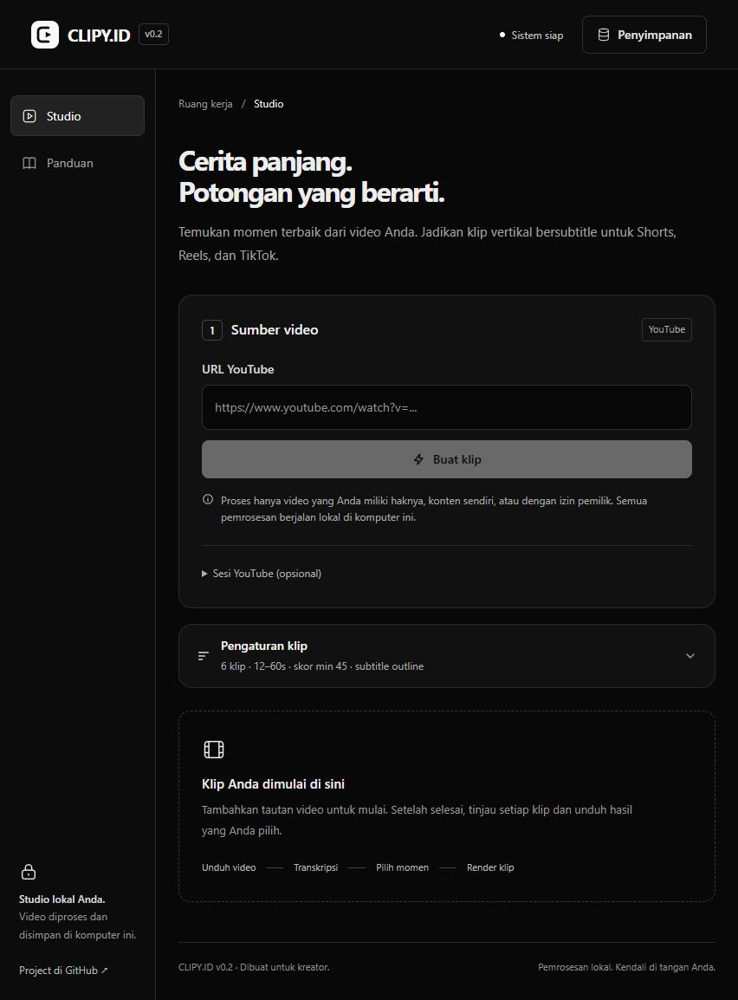

# CLIPY.ID v0.2

**Studio klip video lokal untuk kreator.** Ubah video YouTube panjang menjadi potongan vertikal 9:16 dengan subtitle, pratinjau, dan aset publikasi. Dibangun dengan React, TypeScript, FastAPI, Whisper, OpenCV, FFmpeg, dan yt-dlp.

CLIPY.ID sebelumnya bernama **klipersid**. Versi 0.2 merupakan rilis awal untuk dijalankan sendiri di komputer Windows atau macOS, dengan tampilan hitam-putih yang responsif. Tidak memerlukan akun CLIPY.ID, langganan, atau API key.



## Baru di v0.2: framing tetap

Mode **Framing tetap** menjadi default. Tekniknya mengadaptasi pendekatan held-crop pada CLIPY.ID 2: deteksi pergantian shot dengan FFmpeg, tentukan satu posisi wajah utama yang konsisten untuk tiap shot, lalu kunci crop. Video dan audio tetap berjalan. Posisi hanya berganti langsung ketika shot kamera berubah; zoom otomatis tidak dipakai pada mode ini.

Buka **Pengaturan klip → Gerakan framing** untuk memilih **Mengikuti wajah** bila Anda ingin crop bergerak seperti versi sebelumnya. Zoom tambahan tersedia pada mode itu. Matikan **Framing wajah** untuk crop tengah. Thumbnail kini diambil dari hasil render agar framing-nya sesuai klip, termasuk ketika sumber tidak disimpan.

Deteksi wajah memakai Haar Cascade lokal yang sudah tersedia. Rilis ini tidak mengadopsi deteksi pembicara berbasis gerakan mulut, layout multi-panel, atau model YuNet/MediaPipe dari proyek referensi. Wajah yang dipilih adalah posisi deteksi paling konsisten dalam shot, sehingga perlu ditinjau pada percakapan dengan banyak orang. Perubahan berlaku untuk klip yang dibuat ulang.

## Apa yang bisa dilakukan?

- Mengunduh satu video YouTube dari tautan watch, youtu.be, Shorts, embed, atau live.
- Membuat transkrip lokal menggunakan faster-whisper dengan waktu per kata.
- Menilai kandidat momen dari teks, fitur audio, dan wajah, lalu memilih potongan yang tidak tumpang tindih.
- Menghasilkan MP4 vertikal **720 × 1280**, framing tetap per shot kamera, mode mengikuti wajah, serta zoom opsional pada mode mengikuti wajah.
- Menanamkan subtitle dengan gaya outline, shadow, atau box; file subtitle ASS juga tersedia.
- Menampilkan progres, pembatalan proses, dan pratinjau klip.
- Menyiapkan judul, hook, deskripsi, hashtag, kata kunci, serta thumbnail setelah klip dipilih.
- Mengelola video unduhan, hasil render, dan cache dari aplikasi.

**Cara analisis bekerja:** penilaian momen menggunakan aturan dan indikator lokal, bukan LLM. Aset teks dibuat dari template berbasis kata kunci. Skor membantu menyaring kandidat dan tidak menjamin viralitas. Selalu tinjau isi, subtitle, dan framing sebelum publikasi. Materi dengan percakapan atau narasi yang jelas, terutama bahasa Indonesia/Inggris, paling sesuai.

## Persiapan komputer

| Komponen | Kebutuhan |
| --- | --- |
| Python | 3.10–3.13; disarankan 3.12, 64-bit |
| Node.js | 22.12+ atau 24 LTS, beserta npm |
| Git | Untuk mengunduh dan memperbarui source |
| FFmpeg | `ffmpeg` dan `ffprobe` tersedia di PATH; build dengan filter `subtitles`/libass |
| Koneksi internet | Untuk instalasi, unduhan YouTube, dan unduhan model pertama kali |
| Penyimpanan | Cukup untuk video sumber, model suara, dan klip hasil render |

GPU tidak wajib. Windows dapat memakai NVIDIA CUDA bila runtime CUDA/cuBLAS yang sesuai tersedia; aplikasi mencoba kembali ke CPU bila tidak tersedia. macOS berjalan melalui CPU; akselerasi Apple Metal tidak disediakan oleh backend CTranslate2 ini. Gunakan model tiny/base terlebih dahulu; model lebih besar memerlukan lebih banyak RAM dan waktu.

> Repository ini public dan dapat diunduh tanpa undangan. Nama CLIPY.ID merupakan identitas proyek, bukan layanan web yang di-host.

## Instalasi di Windows

### 1. Pasang kebutuhan

Pasang Python 3.12, Node.js LTS, Git, dan FFmpeg dari sumber resminya. Jika menggunakan Windows Package Manager, jalankan PowerShell:

```powershell
winget install --id Python.Python.3.12 -e
winget install --id OpenJS.NodeJS.LTS -e
winget install --id Git.Git -e
winget install --id Gyan.FFmpeg -e
```

Buka ulang PowerShell agar PATH diperbarui. Pastikan `python --version` menunjukkan Python 3.10–3.13. Bila komputer memiliki beberapa Python, gunakan `py -3.12` sebagai pengganti `python` pada semua langkah di bawah.

### 2. Unduh dan siapkan

```powershell
git clone https://github.com/nativmedia/CLIPY.ID-v0.1.git
cd CLIPY.ID-v0.1
python manage.py check
python manage.py setup
```

Setup membuat lingkungan Python terpisah di `backend/.venv`, memasang dependensi, dan membangun antarmuka. Tidak mengubah instalasi paket Python global.

### 3. Jalankan

```powershell
python manage.py run
```

Buka **http://127.0.0.1:8000** di browser. Biarkan terminal berjalan. Tekan **Ctrl+C** untuk menghentikan aplikasi.

Setelah setup, Anda juga dapat klik dua kali **Jalankan-CLIPY.cmd**. Jika Python 3.12 hanya tersedia melalui Python Launcher, gunakan perintah `py -3.12 manage.py run` dari terminal.

## Instalasi di macOS

### 1. Pasang kebutuhan

Pasang [Homebrew](https://brew.sh/) mengikuti instruksi resminya bila belum tersedia, lalu buka Terminal:

```bash
brew install python@3.12 node@22 git ffmpeg
```

Pastikan Node.js dan Python yang dipilih tersedia untuk shell Anda. Bila `node` belum ditemukan, ikuti petunjuk PATH dari `brew info node@22`, lalu buka ulang Terminal.

### 2. Unduh dan siapkan

```bash
git clone https://github.com/nativmedia/CLIPY.ID-v0.1.git
cd CLIPY.ID-v0.1
python3.12 manage.py check
python3.12 manage.py setup
```

### 3. Jalankan

```bash
python3.12 manage.py run
```

Buka **http://127.0.0.1:8000** dan biarkan Terminal berjalan. Tekan **Ctrl+C** untuk berhenti. Jika `python3` di komputer Anda sudah menggunakan versi 3.10–3.13, Anda juga dapat menggunakan `python3 manage.py run` atau menjalankan **Jalankan-CLIPY.command**.

Panduan macOS disediakan untuk instalasi dari source; pengujian lokal rilis ini dilakukan di Windows. Workflow GitHub Actions menyertakan pemeriksaan backend Windows, macOS, dan Linux; itu tidak menggantikan pengujian video penuh di setiap perangkat.

## Memperbarui dari v0.1

Hentikan server, lalu dari folder repository jalankan:

```bash
git pull
python manage.py setup
python manage.py run
```

Di macOS gunakan `python3.12`. Nama repo tetap `CLIPY.ID-v0.1` agar tautan clone sebelumnya terus berfungsi; versi aplikasi dan rilis terbaru adalah **v0.2**. Data lokal tidak dihapus oleh setup. Klip lama tetap memakai framing lama dan perlu diproses ulang untuk mendapatkan framing tetap.

## Cara menggunakan

1. Buka **Studio** dan pastikan status menunjukkan **Sistem siap**.
2. Tempel URL YouTube dari konten milik Anda atau yang Anda diizinkan memproses.
3. Buka **Pengaturan klip** bila ingin mengubah jumlah, rentang durasi, skor minimum, jenis momen, gaya subtitle, bahasa, model suara, reframe, atau zoom.
4. Klik **Buat klip**. Model Whisper terpilih diunduh saat pertama digunakan. Tunggu unduhan video, transkripsi, analisis, dan render selesai; durasi tergantung perangkat dan panjang video.
5. Putar hasil dan centang klip yang ingin digunakan. Klik **Buat aset publikasi** untuk menyiapkan teks dan thumbnail.
6. Unduh MP4 dari panel aset. Salin judul, deskripsi, hashtag, dan tag sesuai kebutuhan. Publikasi ke platform dilakukan secara manual.
7. Gunakan **Penyimpanan** jika ingin menghapus sumber dan hasil. Simpan salinan hasil yang diperlukan terlebih dahulu; penghapusan ini tidak dapat dibatalkan.

## Sesi YouTube opsional

Sebagian video dapat dibatasi atau memerlukan login. Buka **Sesi YouTube (opsional)** di bawah formulir sumber:

- **Sambungkan Chrome** membaca cookie YouTube dari profil Chrome utama secara lokal, hanya setelah tombol ditekan. Tutup Chrome bila profil terkunci.
- Jika pembacaan profil ditolak enkripsi OS, Anda dapat mengimpor sendiri ekspor cookie Netscape UTF-8 untuk `youtube.com` (maksimal 256 KB).
- Cookie sesi ditahan di memori server, tidak ditulis oleh aplikasi ke file, dan hilang setelah **Putuskan sesi** atau server dihentikan. Ekspor cookie yang Anda buat sendiri tetap perlu Anda amankan.
- Sesi akun tidak menjamin unduhan diterima. Video berbayar, private, pembatasan akun, dan perubahan kebijakan YouTube dapat menyebabkan kegagalan.

Jangan unggah file cookie ke GitHub atau membagikannya kepada orang lain. Gunakan aplikasi di localhost, karena sesi dan file hasil tidak dirancang untuk akses publik atau banyak pengguna sekaligus.

## Data dan privasi

Pemrosesan video, transkripsi, analisis, dan aset berjalan di komputer Anda. yt-dlp tetap menghubungi YouTube untuk mengambil video/metadata; model Whisper diambil dari layanan penyedia model saat belum tersedia. CLIPY.ID tidak membutuhkan layanan AI berbayar untuk pipeline ini.

```text
data/
  downloads/   Video sumber
  jobs/        Klip, subtitle, thumbnail, dan file kerja
  models/      Model Whisper
  logs/        Log lokal jika diarahkan ke sini
```

Folder `data/`, `.venv`, dan dependensi frontend tidak masuk Git. Riwayat pekerjaan aktif berada di memori dan hilang setelah server dimulai ulang, walaupun file hasil di disk tetap ada. Unduh atau salin hasil sebelum restart. `Simpan video sumber` mengatur apakah sumber disimpan setelah proses; model tidak dihapus tombol pembersihan cache.

## Pemecahan masalah

| Masalah | Langkah yang dapat dicoba |
| --- | --- |
| FFmpeg/FFprobe tidak terdeteksi | Buka ulang terminal setelah instalasi, jalankan `ffmpeg -version` dan `ffprobe -version`, lalu `python manage.py check`. |
| Port 8000 sudah dipakai | Jalankan `python manage.py run --port 8080`, lalu buka http://127.0.0.1:8080. |
| Unduhan YouTube gagal | Pastikan video dapat diakses; coba sesi opsional bila diminta login. Perbarui yt-dlp di lingkungan aplikasi dengan `backend/.venv/Scripts/python.exe -m pip install -U yt-dlp` (Windows) atau `backend/.venv/bin/python -m pip install -U yt-dlp` (macOS). |
| Transkripsi lambat atau memori tidak cukup | Pilih model tiny/base dan coba video yang lebih pendek. CPU memerlukan waktu lebih lama. |
| CUDA/DLL atau kebijakan Windows menolak modul | Gunakan CPU bila runtime CUDA tidak tersedia. Jika OS menolak modul, instal ulang paket dari sumber tepercaya dan periksa kebijakan perangkat; jangan menonaktifkan proteksi OS. |
| Tidak ada klip terpilih | Turunkan skor minimum, longgarkan filter jenis momen, dan gunakan sumber dengan percakapan yang jelas. |
| Subtitle/render gagal | Pastikan FFmpeg menyertakan libass: `ffmpeg -filters`; baca log aktivitas dan pesan kesalahan di aplikasi. |
| Halaman tidak muncul setelah clone | Jalankan setup sampai build frontend selesai, lalu mulai ulang server. |

## Pengembangan

Frontend menggunakan React 18, TypeScript, Vite, dan Tailwind. Backend menggunakan FastAPI, faster-whisper/CTranslate2, OpenCV, NumPy, FFmpeg, dan yt-dlp.

Untuk pengembangan antarmuka (jalankan dua terminal dari root repo):

```bash
# Terminal pertama
python manage.py run

# Terminal kedua
cd frontend
npm run dev
```

Buka http://127.0.0.1:5173. Vite meneruskan `/api` dan `/ws` ke backend pada port 8000. Untuk memperbarui antarmuka produksi, jalankan `npm run build` di folder frontend, kemudian restart backend.

Pemeriksaan frontend:

```bash
cd frontend
npm ci
npm run build
```

Pemeriksaan backend (Windows):

```powershell
cd backend
.\.venv\Scripts\python.exe -m pip install -r requirements-dev.txt
.\.venv\Scripts\python.exe -m unittest discover -p "test_*.py" -v
```

macOS: gunakan `.venv/bin/python` sebagai pengganti `.venv\Scripts\python.exe`. API tersedia di `/docs`. Pengujian API tidak mengunduh video/model atau mempublikasikan konten.

## Batas versi 0.2

- Input utama berupa tautan YouTube; unggah file lokal dan editor timeline belum tersedia.
- Hanya keluaran vertikal 720 × 1280; belum ada ekspor 1080p atau rasio lain.
- Aset teks berasal dari template, sehingga perlu disunting sesuai konteks.
- Riwayat belum persisten lintas restart server, dan belum ada installer mandiri.
- Dipakai sebagai aplikasi pribadi di localhost. Belum mendukung hosting publik, autentikasi pengguna, atau kolaborasi banyak akun.

Dibuat oleh **nativmedia**. Lihat [CHANGELOG.md](CHANGELOG.md) untuk perubahan versi. Lisensi dependensi tetap mengikuti proyek masing-masing.
